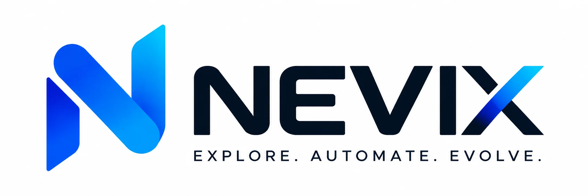

<div align="center">



**Explore. Automate. Evolve.**

Intelligence in Motion
·
Intelligent Technology for a Smarter Tomorrow
·
AI • Automation • Digital Engineering • Data & Analytics

</div>

---

The NEVIX website and platform foundation: a Next.js marketing site, a FastAPI lead-capture
backend, and a self-hosted Strapi CMS — all open source, all self-hostable, deployed with Docker
Compose behind Nginx.

**Source of truth:** [`docs/source-material/`](docs/source-material/) holds the supplied
specification and service catalogue. Plain-text extractions are committed alongside them so
changes are diffable. Both predate the rename to NEVIX on 2026-10-10 and are kept exactly as
supplied ([ADR-014](docs/architecture/adr/ADR-014-nevix-rebrand.md)).

**Brand:** the original artwork is in [`brand-assets/nevix/`](brand-assets/nevix/); see
[Brand assets](#brand-assets). A Brand page showing the mark, wordmark, palette, typefaces and every
supplied picture is built at [`/brand`](apps/web/app/(marketing)/brand/page.tsx) but **hidden** for
now: it answers 404 and nothing links to it. Set `BRAND_PAGE_ENABLED` in
[`content/brand.ts`](apps/web/content/brand.ts) to `true` to bring it back with its footer link and
sitemap entry.

---

## Contents

- [Quick start](#quick-start)
- [What is here](#what-is-here)
- [Architecture](#architecture)
- [Local development](#local-development)
- [Environment variables](#environment-variables)
- [Testing](#testing)
- [Build and deploy](#build-and-deploy)
- [Content governance](#content-governance)
- [Documentation](#documentation)
- [Troubleshooting](#troubleshooting)

---

## Quick start

### With Docker (recommended)

```bash
git clone <repository> nevix-website && cd nevix-website

cp .env.example .env
./scripts/generate-secrets.sh --write      # generates every secret, chmod 600

docker compose -f docker-compose.yml -f docker-compose.dev.yml up -d
```

| Service | URL |
| --- | --- |
| Website | http://localhost:3000 |
| API | http://localhost:8000 |
| API docs | http://localhost:8000/docs |
| CMS admin | http://localhost:1337/admin |
| Mail capture | http://localhost:8025 |

Nothing leaves your machine: Mailpit captures all outbound email.

### Without Docker

```bash
# Prerequisites: Node 22.12+ (see .nvmrc), Python 3.12+, PostgreSQL 16

npm install
npm run dev                       # http://localhost:3000

cd apps/api
python -m venv .venv && .venv/bin/pip install -e ".[dev]"
.venv/bin/alembic upgrade head
.venv/bin/uvicorn app.main:app --reload
```

The site serves its committed content by default, so **no CMS is required to run or build it**
(see [ADR-006](docs/architecture/adr/ADR-006-content-provider-abstraction.md)).

---

## What is here

```
nevix-website/
├── apps/
│   ├── web/          Next.js 16 — 118 prerendered routes
│   ├── api/          FastAPI — leads, newsletter, uploads, admin
│   └── cms/          Strapi CE — 11 content types, 6 components
├── packages/
│   ├── types/        Shared domain and API contract types
│   └── config/       Shared TypeScript and ESLint config
├── infra/
│   ├── nginx/        Reverse proxy, TLS, security headers, rate limits
│   ├── docker/       Container init scripts
│   └── monitoring/   Prometheus, Grafana, Loki, alert rules
├── brand-assets/     Supplied NEVIX artwork — the originals, never edited
├── docs/             Architecture, ADRs, deployment, security, licences
├── scripts/          Backup, restore, rollback, secrets, audits, brand-asset derivation
└── tests/e2e/        Playwright — critical flows from specification §27.1
```

### Site map

| Section | Routes |
| --- | --- |
| Home, About, Team | 3 (Brand is built but hidden) |
| Services | 1 index + 6 categories + 35 services |
| Solutions | 1 index + 10 details |
| Industries | 1 index + 6 details |
| Products | 1 index + 3 details |
| Case Studies | 1 index + 4 details |
| Insights | 1 index + 6 articles + categories + tags |
| Contact, Search, Legal | 5 |

---

## Architecture

```
Internet → Nginx (TLS, headers, rate limits)
             ├── nevix.ai      → Next.js ──proxy──┐
             ├── api.nevix.ai  → FastAPI ◄────────┘
             └── cms.nevix.ai  → Strapi
                                     │
                          internal network (no egress)
                                     └── PostgreSQL
```

The browser only ever talks to one origin. The website proxies API calls through
`/api/backend/*`, which keeps `connect-src 'self'` intact in the Content Security Policy and means
no CORS is needed on public endpoints.

PostgreSQL publishes **no port at all** and sits on a Docker network declared `internal: true`.

Full detail: [`docs/architecture/architecture-overview.md`](docs/architecture/architecture-overview.md).

### Stack

| Layer | Technology |
| --- | --- |
| Frontend | Next.js 16, React 19, TypeScript, Tailwind CSS 4, Radix UI, Framer Motion |
| Backend | Python 3.12, FastAPI, Pydantic v2, SQLAlchemy 2 (async), Alembic |
| Database | PostgreSQL 16 (pgvector image) |
| CMS | Strapi Community Edition 5 |
| Infrastructure | Docker Compose, Nginx |
| CI/CD | GitLab CE |
| Observability | Prometheus, Grafana, Loki, GlitchTip |

Every component is open source and self-hostable. No third-party SaaS is required to run the
system, and there is no analytics vendor, CDN dependency or font CDN. Licence inventory:
[`docs/licenses/`](docs/licenses/).

---

## Local development

```bash
npm run dev              # Next.js dev server
npm run build            # production build (118 routes)
npm run serve:standalone # run the exact artifact the container runs

npm run lint             # ESLint
npm run typecheck        # tsc --noEmit, strict
npm run test             # Vitest
npm run format           # Prettier

npm run verify           # everything the CI pipeline runs
```

**Node is not installed system-wide?** `scripts/env.sh` adds a repository-local toolchain to
`PATH` if one is present in `.tooling/`.

### Backend

```bash
cd apps/api
.venv/bin/pytest                          # 55 tests
.venv/bin/ruff check app tests            # lint
.venv/bin/alembic revision --autogenerate -m "description"
.venv/bin/alembic upgrade head
```

---

## Environment variables

Every variable is documented in [`.env.example`](.env.example). Only `.env.example` is ever
committed.

The essentials:

| Variable | Purpose |
| --- | --- |
| `SECRET_KEY` | Signing and IP hashing. ≥32 chars, generated |
| `ADMIN_API_KEY` | Admin API bearer token. **Leave empty to disable the admin API entirely** |
| `POSTGRES_USER` / `POSTGRES_PASSWORD` | Database credentials |
| `NEXT_PUBLIC_SITE_URL` | Canonical origin — inlined at **build** time |
| `NEXT_PUBLIC_ENV` | Anything other than `production` makes robots.txt disallow all crawling |
| `CONTENT_PROVIDER` | `local` (default) or `strapi` |
| `SMTP_*`, `EMAIL_NOTIFY_TO` | Notifications. Leave empty to disable — enquiries are still recorded |

```bash
./scripts/generate-secrets.sh          # print
./scripts/generate-secrets.sh --write  # write to .env, refusing to overwrite a set value
```

The API **refuses to start in production** if `DEBUG=true`, `SECRET_KEY` is short, `CORS_ORIGINS`
contains `*`, or the database URL still holds the development credentials.

---

## Testing

| Suite | Count | Command |
| --- | ---: | --- |
| Backend (pytest) | 55 | `cd apps/api && .venv/bin/pytest` |
| Content integrity + governance (Vitest) | 48 | `npm run test` |
| End-to-end (Playwright, desktop + mobile) | 92 | `npm run test:e2e` |
| Accessibility + responsive sweep | 35 routes × 3 viewports | `npm run audit:pages` |
| Dummy-data registry | — | `npm run audit:dummy-data` |
| Committed secrets | — | `npm run audit:secrets` |
| Licence inventory | — | `npm run licenses:inventory` |

The content tests enforce [specification §31 and catalogue §16](#content-governance)
mechanically — no invented certifications, no guaranteed ROI, no fabricated metrics, no client
names on demo case studies. They were verified by injecting violations and confirming the suite
fails.

> **On a OneDrive- or Dropbox-synced checkout**, set `PLAYWRIGHT_OUTPUT_DIR` to a path outside the
> synced folder. The sync client locks artifact files mid-write and Playwright fails to finalise
> traces.

---

## Build and deploy

```bash
docker compose build
docker compose up -d
```

CI (`.gitlab-ci.yml`): lint → type-check → tests → migration test on real PostgreSQL → build →
security scans → image build → **staging** → *manual approval* → **production**.

Production deployment takes a backup before running migrations, then smoke-tests afterwards.

```bash
./scripts/rollback.sh                  # code rollback, ~1 minute
./scripts/backup-database.sh           # manual backup
./scripts/restore-database.sh --verify # prove a backup actually restores
./scripts/issue-certificates.sh nevix.ai
```

- [Deployment](docs/architecture/deployment.md)
- [Rollback](docs/deployment/rollback.md)
- [Backup and restore](docs/deployment/backup-and-restore.md)
- [Runbook](docs/deployment/runbook.md)

### The welcome intro

A logo reveal plays on a first homepage visit: the N writes itself in light — up the left stroke,
down the diagonal, up the right stroke — uncovering the supplied artwork behind a point of light,
then a sweep crosses it and the wordmark and tagline settle. About 3.6s. The stroke centre lines
and lockup ratios are measured data in [`lib/brand/mark-geometry.ts`](apps/web/lib/brand/mark-geometry.ts).

| To change | Where |
| --- | --- |
| **Turn it off** | `NEXT_PUBLIC_SHOW_INTRO=false` — never rendered, not merely hidden |
| **Speed** | `durationScale` in [`lib/brand/intro-config.ts`](apps/web/lib/brand/intro-config.ts) |
| **Choreography** | the `timeline` in the same file — absolute milliseconds per phase |
| **Intensity** | `MOTE_COUNT` there, and the gradients in [`ambient-background.tsx`](apps/web/components/branding/ambient-background.tsx) |
| **Replay frequency** | clear the `nevix_intro_seen` session key, or drop the check in [`app/layout.tsx`](apps/web/app/layout.tsx) |
| **Skip** | the button in [`skip-intro.tsx`](apps/web/components/branding/skip-intro.tsx); Escape is wired in `nevix-intro-stage.tsx` |

Never plays under `prefers-reduced-motion: reduce`, on any page but `/`, or without JavaScript.
Page content is prerendered either way, so the intro costs nothing in SEO terms. See
[ADR-013](docs/architecture/adr/ADR-013-welcome-intro.md).

### Team page

`/team` publishes the supplied team cards whole and uncropped, so each arrives as it was designed —
each framed at its own ratio (the CEO's card is 3:2, the co-founder's square). The founders' cards
appear only here. Content is in [`content/about.ts`](apps/web/content/about.ts) → `team`.

Each entry states **only** a name, a role and the quote credited to that person. No biography,
career history or qualification appears, because none was supplied — and a content test fails if
any is added later.

Because the cards carry their text as artwork, the same facts are served separately to anything
that cannot see a picture: derived alternative text, a visually hidden caption, and `Person`
structured data. To add someone: drop their card in `brand-assets/nevix/`, add a `picture()` call
for it beside the existing team cards in
[`scripts/derive-brand-assets.mjs`](scripts/derive-brand-assets.mjs), run `npm run brand:assets`,
then add the entry to `team`.

### Brand assets

The supplied NEVIX artwork in [`brand-assets/nevix/`](brand-assets/nevix/) (plus
`brand-assets/logo-summary.png`) is the source of truth and is never edited. Everything the site
serves from it — `apps/web/public/brand/`, `apps/web/public/team/`, and the favicon and app icons
in `apps/web/app/` — is *derived* and reproducible:

```bash
npm run brand:assets     # regenerate
npm run brand:check      # verify they are current (runs in `npm run verify`)
```

The supplied logos are flattened onto white or midnight. The script separates the mark and the
wordmark from that background by un-compositing each edge pixel rather than keying out a colour,
so there is no halo on light or dark; it also crops the homepage hero from the logo-free part of
the workspace photograph and re-encodes every board whole as WebP for the
[`/brand`](apps/web/app/(marketing)/brand/page.tsx) page (currently hidden). Shape, proportion and gradient are
untouched. See [`scripts/derive-brand-assets.mjs`](scripts/derive-brand-assets.mjs) and
[ADR-014](docs/architecture/adr/ADR-014-nevix-rebrand.md).

**Design system:** electric blue `#0B5CFF`, cyan `#00C8FF`, indigo `#1F2FD6`, midnight `#050B1A`,
cloud `#F6F8FC`, and a sunset horizon `#FF9A4D` used only for hairlines and glows. Headings in Sora,
body in Manrope. Tokens in [`app/globals.css`](apps/web/app/globals.css).

### Sharing a preview over ngrok

For review before there is a server — a tunnel from a public address to the site running locally.

```bash
export NGROK_DOMAIN=<your-reserved-domain>   # omit for a random address
npm run serve:public
```

This starts the tunnel, asks it what address it was given, rebuilds if that address changed, then
serves. The rebuild is the point: `NEXT_PUBLIC_SITE_URL` is baked in at build time, so serving an
existing build through a tunnel publishes canonical links and a sitemap pointing at `localhost`.

Reserving a domain (free, one per ngrok account) keeps the address stable across restarts, which
also lets the rebuild be skipped — a restart then takes seconds.

`NEXT_PUBLIC_ENV` defaults to `staging` here, so `robots.txt` disallows everything. Leave it that
way until the placeholders in [`docs/dummy-data/`](docs/dummy-data/) are replaced — see
[content governance](#content-governance).

**This is a preview, not a deployment.** It serves from a workstation, has no TLS of its own, no
monitoring and no backups. Production is Docker Compose behind Nginx, as above.

---

## Content governance

NEVIX is a new company. The supplied material contains no verified client work, products, team
biographies, testimonials or legal entity details — and the specification forbids inventing them.

**Every placeholder is registered, labelled in the UI and marked in the code.**

```bash
npm run audit:dummy-data
```

The audit cross-checks `DUMMY-DATA: DD-nnn` markers in the source against
[`docs/dummy-data/registry.md`](docs/dummy-data/registry.md) and fails on any mismatch. It runs in
CI.

Nothing on this site claims a certification, government approval, empanelment, client
relationship, testimonial, ROI figure or headcount. Demo case studies are labelled *Demo Case
Study* and excluded from search indexing; products are at *Concept* status; legal pages are marked
**DRAFT**.

Before launch: [`docs/dummy-data/replacement-checklist.md`](docs/dummy-data/replacement-checklist.md).

---

## Documentation

| Area | Document |
| --- | --- |
| Implementation plan | [`docs/implementation-plan.md`](docs/implementation-plan.md) |
| Architecture | [overview](docs/architecture/architecture-overview.md) · [frontend](docs/architecture/frontend.md) · [backend](docs/architecture/backend.md) · [database](docs/architecture/database.md) · [cms](docs/architecture/cms.md) · [deployment](docs/architecture/deployment.md) |
| Decisions | [14 ADRs](docs/architecture/adr/) |
| Security | [threat model](docs/security/threat-model.md) |
| Operations | [runbook](docs/deployment/runbook.md) · [rollback](docs/deployment/rollback.md) · [backup](docs/deployment/backup-and-restore.md) |
| Licences | [`docs/licenses/`](docs/licenses/) |
| Content governance | [`docs/dummy-data/`](docs/dummy-data/) |

---

## Troubleshooting

**`next build` fails with EBUSY on `.next/standalone`**
A standalone server is holding the directory. Stop it, or use
`scripts/serve-standalone.mjs`, which stages to a port-specific copy outside `.next`.

**Contact form returns 502**
The API is unreachable. `docker compose ps api` and check `API_INTERNAL_URL`.

**Site shows no content after switching to Strapi**
Strapi has no published entries. Run the seed
(`cd apps/cms && npm run seed`), publish the drafts, and grant the Public role `find`/`findOne`.

**CMS requests fail with 401**
`CMS_API_TOKEN` is missing or not read-only. Re-issue it in *Settings → API Tokens*.

**Headings render at body size**
A custom `text-display-*` class was dropped by `tailwind-merge`. Custom scales must be registered
in `lib/utils.ts` — see [frontend.md §5](docs/architecture/frontend.md).

**Playwright fails every test with `ENOENT ... .playwright-artifacts`**
Set `PLAYWRIGHT_OUTPUT_DIR` outside your synced folder.

**Migrations fail on container start**
Check `docker compose logs api`. The entrypoint retries ten times; set `RUN_MIGRATIONS=false` when
a separate job owns migrations.

---

<div align="center">

**NEVIX** — Explore. Automate. Evolve.

</div>


